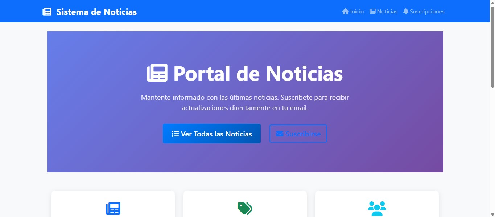
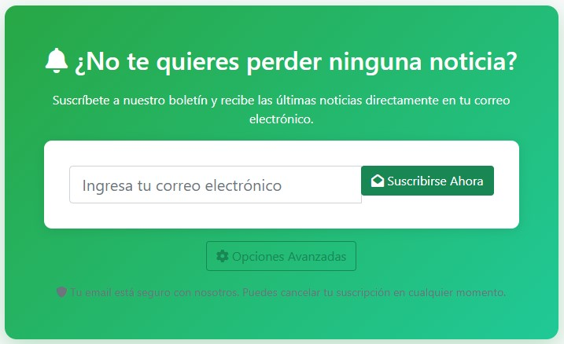
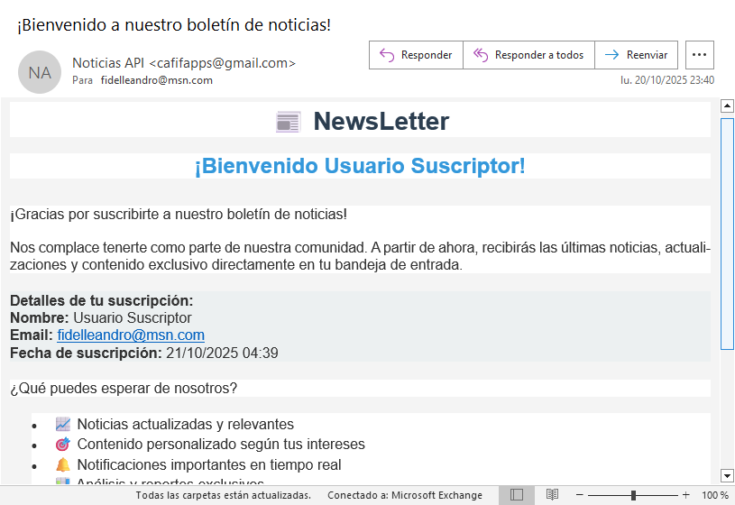

# Sistema de Suscripción de Noticias - Cliente Frontend

Un sistema de suscripción de noticias desarrollado con AngularJS que permite a los usuarios suscribirse a diferentes categorías de noticias y recibir notificaciones por email.

## 📋 Características

- **Gestión de Suscripciones**: Los usuarios pueden suscribirse y desuscribirse de diferentes categorías de noticias
- **Visualización de Noticias**: Interfaz para ver noticias organizadas por categorías
- **Notificaciones por Email**: Sistema de envío de notificaciones automáticas
- **Interfaz Responsiva**: Diseño adaptable usando Bootstrap 5
- **SPA (Single Page Application)**: Navegación fluida sin recargas de página

## 🛠️ Tecnologías Utilizadas

- **Frontend**: AngularJS 1.7.9
- **CSS Framework**: Bootstrap 5.1.3
- **Iconos**: Font Awesome 6.0.0
- **HTTP Client**: jQuery 3.6.0
- **Servidor Local**: PHP Built-in Server

## 📁 Estructura del Proyecto

```
news-subscription-client/
├── css/
│   └── app.css                 # Estilos personalizados
├── images/                     # Imágenes del sistema
│   ├── envio-suscripcion.png  # Imagen de envío de suscripción
│   ├── sistema.jpg            # Imagen del sistema
│   └── suscripcion.jpg        # Imagen de suscripción
├── js/
│   ├── app.js                 # Configuración principal de AngularJS
│   ├── controllers/           # Controladores de AngularJS
│   │   ├── homeController.js
│   │   ├── newsController.js
│   │   └── subscriptionController.js
│   └── services/
│       └── apiService.js      # Servicio para comunicación con API
├── views/                     # Plantillas HTML
│   ├── home.html
│   ├── news-detail.html
│   ├── news.html
│   ├── subscription-form.html
│   ├── subscriptions.html
│   └── unsubscribe.html
├── .htaccess                  # Configuración Apache
├── index.html                 # Página principal
└── README.md                  # Este archivo
```

## 🚀 Instalación y Configuración

### Prerrequisitos

- **PHP 8.2 o superior** (para el servidor local)
- **Navegador web moderno** (Chrome, Firefox, Safari, Edge)
- **Conexión a internet** (para cargar las dependencias CDN)

### Pasos de Instalación

1. **Clonar o descargar el proyecto**
   ```bash
   git clone https://github.com/fidelleandro2023/news-subscription-client.git
   cd news-subscription-client
   ```

2. **Verificar la estructura de archivos**
   Asegúrate de que todos los archivos estén en su lugar según la estructura mostrada arriba.

3. **Acceder a la aplicación**
   - Abre tu navegador web
   - Navega a `http://localhost:8080` (o la URL correspondiente según tu servidor)

## 🖼️ Capturas de Pantalla

### Sistema Principal

*Vista principal del sistema de suscripción de noticias*

### Proceso de Suscripción

*Interfaz para gestionar suscripciones a categorías de noticias*

### Envío de Notificaciones

*Sistema de envío automático de notificaciones por email*

## 🔧 Configuración Adicional

### Configuración de API Backend

Este frontend está diseñado para trabajar con un backend Laravel. Asegúrate de:

1. **Configurar la URL del API** en `js/services/apiService.js`
2. **Habilitar CORS** en el backend para permitir peticiones desde el frontend
3. **Verificar las rutas** del API que coincidan con las llamadas del frontend

### Variables de Entorno

El proyecto utiliza las siguientes configuraciones que puedes modificar en `js/app.js`:

- **API_BASE_URL**: URL base del backend API
- **DEFAULT_LANGUAGE**: Idioma por defecto (español)
- **PAGINATION_SIZE**: Número de elementos por página

## 🌐 Funcionalidades Principales

### Página de Inicio
- Bienvenida al sistema
- Navegación principal
- Información general del servicio

### Gestión de Noticias
- Listado de noticias por categorías
- Vista detallada de cada noticia
- Filtros y búsqueda

### Sistema de Suscripciones
- Formulario de suscripción
- Gestión de suscripciones existentes
- Proceso de desuscripción
- Confirmación por email

## 🐛 Solución de Problemas

### Error: "No se pueden cargar los recursos"
- Verifica que tengas conexión a internet para cargar las dependencias CDN
- Asegúrate de que el servidor esté ejecutándose correctamente

### Error: "CORS Policy"
- Configura el backend para permitir peticiones desde el dominio del frontend
- Verifica que las URLs del API sean correctas

### Error: "Página no encontrada"
- Verifica que el archivo `.htaccess` esté presente
- Asegúrate de que el servidor soporte URL rewriting

## 📝 Desarrollo

### Estructura de Controladores

- **homeController.js**: Maneja la página de inicio
- **newsController.js**: Gestiona la visualización de noticias
- **subscriptionController.js**: Controla las suscripciones

### Servicios

- **apiService.js**: Centraliza todas las llamadas al backend API
